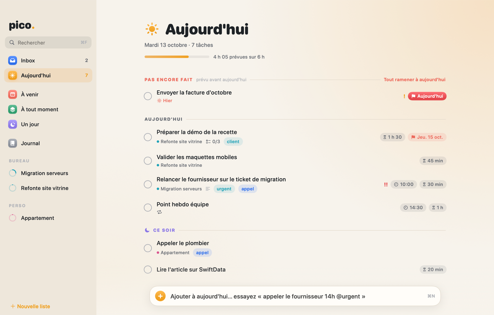
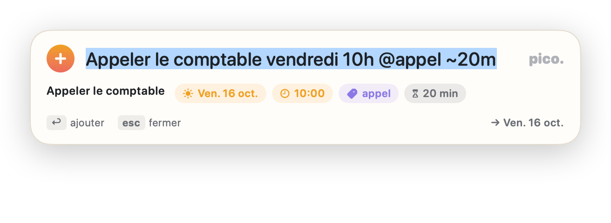
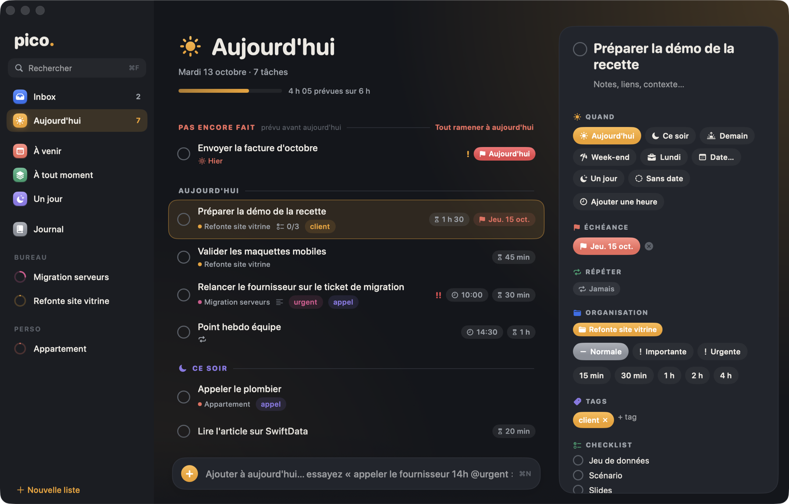
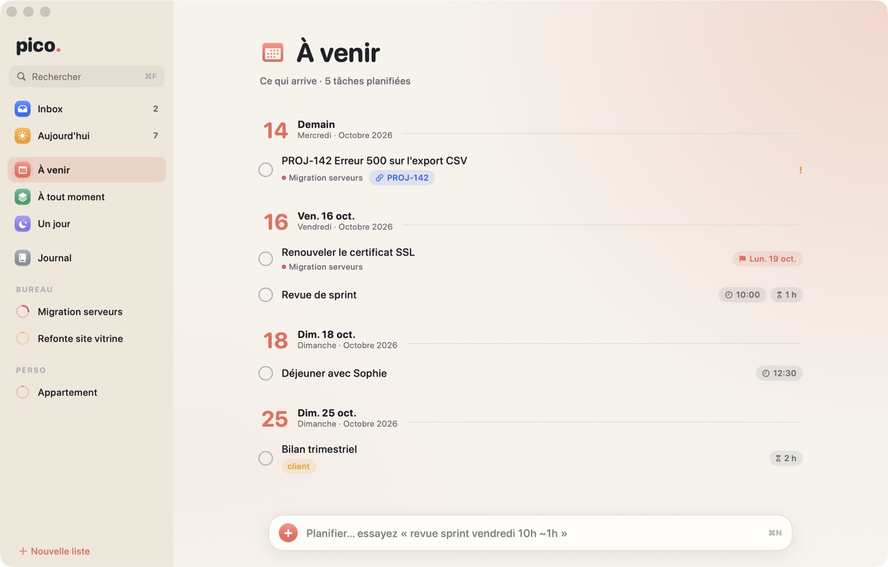
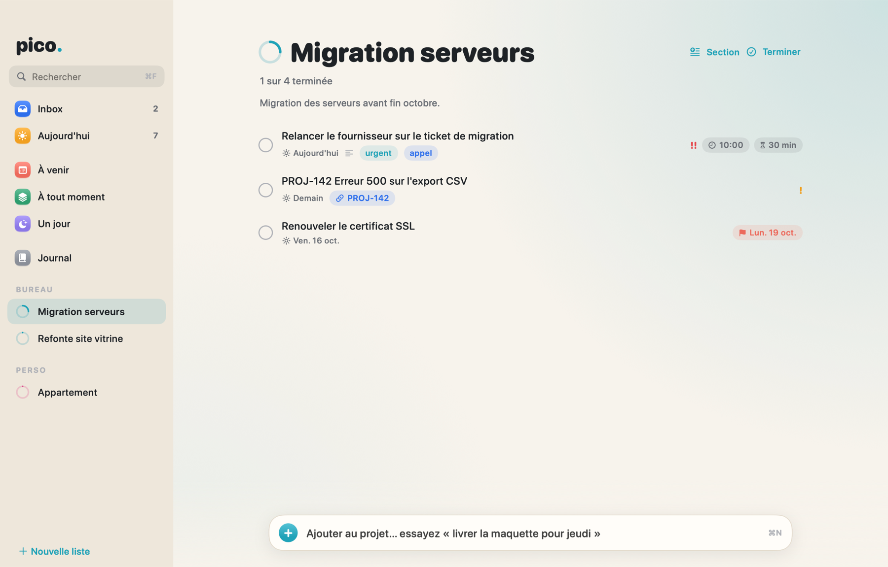
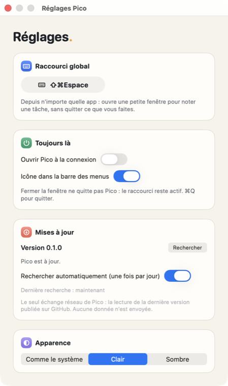

<div align="center">


# Pico

**Le gestionnaire de tâches natif pour Mac qui se laisse alimenter à la vitesse de la pensée.**

Tapez une phrase, Pico comprend la date, l'heure, le projet, la priorité. Une journée claire, sans pile rouge de retards. Vos données restent sur votre Mac.

[](https://github.com/avialet/pico/releases/latest)
[](#installation)
[](LICENSE)

[**Télécharger le DMG**](https://github.com/avialet/pico/releases/latest) · [Site](https://pico.vialet.app) · [Notice](#notice) · [Feuille de route](#feuille-de-route)



</div>

## Pourquoi Pico

Un bureau, c'est des demandes qui arrivent de partout : un ticket, un mail, une idée au détour d'un appel. Ce qui tue une liste de tâches, ce n'est pas d'en avoir trop, c'est la friction pour la tenir à jour. Pico est construit autour de trois idées :

- **Capturer sans réfléchir.** Une seule ligne de texte suffit. Pas de formulaire, pas de menu déroulant.
- **Ne jamais culpabiliser.** Ce qui n'a pas été fait hier attend calmement dans « Pas encore fait », prêt à revenir à aujourd'hui en un clic. Pas de compteur rouge.
- **Rester chez vous.** Tout est stocké dans un fichier SQLite local. Aucun compte, aucun serveur, aucune télémétrie.

## Fonctionnalités

**Saisie en langage naturel**, en français comme en anglais. La barre en bas de la fenêtre affiche en direct ce que Pico a compris :



- **Raccourci global** (⇧⌘Espace par défaut, modifiable) : une petite fenêtre s'ouvre par-dessus n'importe quelle app pour noter une tâche sans quitter ce que vous faites, puis se referme.
- **Icône dans la barre des menus** avec le nombre de tâches du jour et la liste à cocher.
- **Aujourd'hui, À venir, À tout moment, Un jour, Journal** : les listes classiques d'un système de type GTD. « Ce soir » sépare la fin de journée, et une jauge prévient quand les durées estimées dépassent une journée raisonnable.
- **Zones et projets**, avec un anneau d'avancement par projet et des sections.
- **Détail d'une tâche en pastilles** : quand, échéance, répétition, projet, priorité, durée, tags, checklist, notes, lien vers le ticket d'origine.
- **Récurrence** : tous les jours, jours ouvrés, chaque semaine ou certains jours, chaque mois, chaque année, ou « 3 jours après l'avoir terminée ».
- **Date prévue distincte de l'échéance** : décider quand on s'y met n'est pas la même chose que la date limite.
- **Glisser-déposer** pour réordonner, replanifier ou ranger une tâche dans un projet.
- **Clair et sombre**, interface en français.
- **Mises à jour intégrées** : Pico signale une nouvelle version et s'installe tout seul.

<table>
  <tr>
    <td width="50%"></td>
    <td width="50%"></td>
  </tr>
  <tr>
    <td align="center"><sub>Mode sombre et détail d'une tâche</sub></td>
    <td align="center"><sub>À venir, jour par jour</sub></td>
  </tr>
  <tr>
    <td></td>
    <td align="center"></td>
  </tr>
  <tr>
    <td align="center"><sub>Un projet et un ticket venu d'un autre outil</sub></td>
    <td align="center"><sub>Réglages</sub></td>
  </tr>
</table>

## Installation

**Prérequis :** un Mac Apple Silicon sous macOS 26 (Tahoe) ou plus récent.

1. Téléchargez `Pico-X.Y.Z.dmg` depuis la [dernière version](https://github.com/avialet/pico/releases/latest).
2. Ouvrez le DMG et glissez **Pico** dans **Applications**.
3. Lancez Pico. Au premier lancement, macOS peut afficher un avertissement : l'app n'est pas signée avec un certificat Apple Developer. Faites un clic droit sur Pico, choisissez **Ouvrir**, puis confirmez. Autre solution, dans le Terminal :

   ```bash
   xattr -dr com.apple.quarantine /Applications/Pico.app
   ```

Pour vérifier le fichier téléchargé, comparez son empreinte avec celle publiée dans la même version :

```bash
shasum -a 256 -c Pico-X.Y.Z.dmg.sha256
```

### Mises à jour

Pico consulte une fois par jour la dernière version publiée sur GitHub. S'il en existe une plus récente, un bandeau apparaît en bas de la barre latérale : un clic télécharge la version, **vérifie son empreinte SHA-256**, contrôle l'application qu'elle contient, la remplace et relance Pico. Si une étape échoue, l'app installée n'est pas touchée. La recherche automatique se désactive dans **Réglages › Mises à jour**.

Le seul échange réseau de Pico est cette lecture de la version publiée. Aucune donnée n'est envoyée.

## Notice

### Écrire une tâche

Dans la barre en bas de la fenêtre, ou dans la fenêtre du raccourci global, tapez une phrase puis ↩. Tous les éléments sont facultatifs et peuvent apparaître dans n'importe quel ordre.

| Pour indiquer | Écrivez, par exemple | Résultat |
|---|---|---|
| Un jour | `aujourd'hui`, `demain`, `après-demain`, `vendredi`, `lundi prochain`, `ce week-end` | Tâche prévue ce jour-là |
| Dans un délai | `dans 3 jours`, `dans 2 semaines`, `in 1 month` | Date calculée |
| Une date | `12/10`, `25/12/2027`, `12 oct`, `1er novembre`, `oct 20` | Date précise (prochaine occurrence si l'année manque) |
| Une heure | `14h`, `14h30`, `9:15`, `2pm` | Heure fixe (aujourd'hui si aucun jour n'est donné) |
| La fin de journée | `ce soir`, `demain soir` | Section « Ce soir » |
| Pour plus tard | `un jour`, `someday` | Liste « Un jour » |
| Une échéance | `pour vendredi`, `avant le 20 oct`, `échéance 12/10`, `due friday` | Date limite, distincte du jour prévu |
| Une répétition | `chaque jour`, `tous les lundis`, `toutes les 2 semaines`, `jours ouvrés`, `chaque mois`, `tous les 3 jours après achèvement` | Tâche récurrente |
| Un projet | `#Infra`, `#"Refonte du site"` | Rangée dans le projet (créé s'il n'existe pas) |
| Des tags | `@urgent @client` | Un tag par mot |
| La priorité | `!` importante, `!!` urgente | Pastille de priorité |
| Une durée | `~30m`, `~1h`, `~1h30` | Alimente la jauge de la journée |

Exemple complet :

```text
Relancer le fournisseur demain 14h #Infra @urgent !! ~30m pour vendredi
```

Sans jour ni projet, la tâche arrive dans l'**Inbox**. En collant plusieurs lignes d'un coup, vous créez une tâche par ligne.

### Raccourci global et barre des menus

- **⇧⌘Espace** ouvre la fenêtre de capture depuis n'importe quelle app. ↩ ajoute la tâche et referme, esc ferme, un clic ailleurs ferme aussi.
- Le raccourci se change dans **Réglages › Raccourci global**. Il doit comporter au moins ⌘, ⌥ ou ⌃. Pico prévient si la combinaison est déjà prise par une autre app.
- Le lien `pico://new` ouvre la même fenêtre, et `pico://new?title=Appeler%20demain%209h` la préremplit : utile pour un script ou un lanceur. Rien n'est créé tant que vous ne validez pas.
- Fermer la fenêtre principale ne quitte pas Pico : le raccourci et l'icône de la barre des menus restent actifs. **⌘Q** quitte vraiment.
- **Réglages › Toujours là** permet d'ouvrir Pico à la connexion et de masquer l'icône de la barre des menus.

### Raccourcis clavier

| Action | Raccourci |
|---|---|
| Nouvelle tâche (curseur dans la barre de saisie) | ⌘N |
| Nouveau projet · nouvelle zone | ⇧⌘N · ⌥⌘N |
| Rechercher | ⌘F |
| Aller à Inbox, Aujourd'hui, À venir, À tout moment, Un jour, Journal | ⌘1 à ⌘6 |
| Terminer ou rouvrir la tâche sélectionnée | ⌘. ou Espace |
| Renommer | ↩ ou ⌘↩ |
| Prévoir pour aujourd'hui · ce soir · demain | ⌘T · ⌘E · ⇧⌘T |
| Passer en « À tout moment » · « Un jour » | ⌘R · ⌘S |
| Supprimer | ⌘⌫ |
| Se déplacer dans la liste | ↑ ↓ (⇧ ou ⌘ + clic pour sélectionner plusieurs tâches) |
| Afficher ou masquer le détail | ⌥⌘I |
| Réglages | ⌘, |

### Organiser son travail

- **Inbox** : tout ce qui n'a ni jour ni projet. À trier quand vous avez un moment.
- **Aujourd'hui** : ce qui est prévu aujourd'hui, plus « Pas encore fait » pour ce qui était prévu avant. Le bouton « Tout ramener à aujourd'hui » replanifie d'un coup.
- **À venir** : les tâches datées, regroupées par jour.
- **À tout moment** : des tâches rangées dans un projet, sans date.
- **Un jour** : ce qui peut attendre. Rien ne s'y affiche en retard.
- **Journal** : tout ce qui est terminé.
- Glissez une tâche sur une liste de la barre latérale pour la replanifier, ou sur un projet pour l'y ranger. Un clic droit ouvre le menu complet (prévoir, déplacer, supprimer).
- Dans un projet, le bouton **Section** ajoute un en-tête pour regrouper les tâches.

### Vos données

Tout est dans une base SQLite :

```text
~/Library/Application Support/Pico/pico.sqlite
```

Pour sauvegarder Pico, copiez ce dossier. Pour repartir de zéro, quittez Pico et supprimez-le. La base conserve un journal de chaque modification, qui servira à une future synchronisation personnelle.

## Compiler depuis les sources

Il faut Swift 6.3 ou plus récent (les Command Line Tools suffisent, Xcode n'est pas nécessaire).

```bash
git clone https://github.com/avialet/pico.git
cd pico
make test      # tests du noyau
make run       # construit et lance l'app
make install   # installe dans /Applications
make release   # fabrique build/Pico-X.Y.Z.dmg et son empreinte
```

Organisation du dépôt :

| Dossier | Contenu |
|---|---|
| `Packages/PicoCore` | Noyau sans interface : modèles, base SQLite ([GRDB](https://github.com/groue/GRDB.swift)), analyse des phrases, récurrence, versions |
| `Pico` | L'application SwiftUI |
| `Tools/pico-cli` | Outil en ligne de commande `pico` (embryonnaire) |
| `scripts` | Assemblage de l'app, du DMG et de l'icône |
| `docs` | Captures, [publier une version](docs/publier-une-version.md), [tests](docs/tests.md) |

Publier une version ne demande que de modifier `VERSION` puis de pousser un tag `vX.Y.Z` : la CI construit et publie le DMG, et les utilisateurs reçoivent la mise à jour dans l'app.

## Feuille de route

Pico en est à ses débuts, mais il est déjà utilisable au quotidien. Prévu ensuite :

- [ ] Rappels et notifications à l'heure prévue, avec actions « Fait », « Demain », « +1 h »
- [ ] Événements du Calendrier dans Aujourd'hui et À venir
- [ ] Palette de commandes ⌘K
- [ ] Revue hebdomadaire guidée et vues enregistrées (filtres)
- [ ] Ajout depuis l'extérieur : commande `pico add`, Raccourcis et Spotlight (le lien `pico://new` existe déjà)
- [ ] Import de tickets (Jira, Trello, Outlook…) avec lien retour vers l'original, sans doublons
- [ ] Widgets
- [ ] Sauvegarde automatique et synchronisation personnelle entre appareils

## Confidentialité

Pico ne collecte rien. Vos tâches ne quittent jamais votre Mac. La seule requête réseau est la lecture de la dernière version publiée sur GitHub, que vous pouvez désactiver.

## Licence

[MIT](LICENSE) © 2026 Aurélien Vialet
